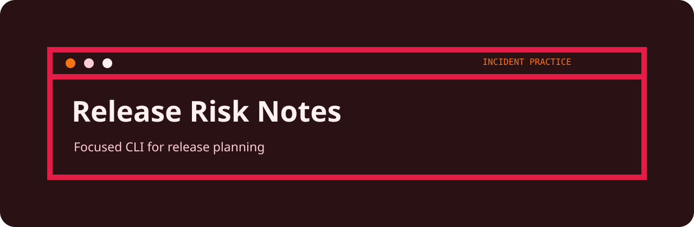

# Release Risk Notes



Generate release risk notes and checklists from changelog or diff text.

`Python`

## Start here

```bash
git clone https://github.com/mertefekurt/release-risk-notes.git
cd release-risk-notes
python -m pip install -e ".[dev]"
release-risk-notes examples/release.txt
```

## Project map

```text
.github/        CI workflow
examples/       sample inputs
src/            package source
tests/          test coverage
.gitignore      project file
pyproject.toml  package metadata
```

## Repository

[Open the source on GitHub →](https://github.com/mertefekurt/release-risk-notes)

[MIT License](LICENSE)
